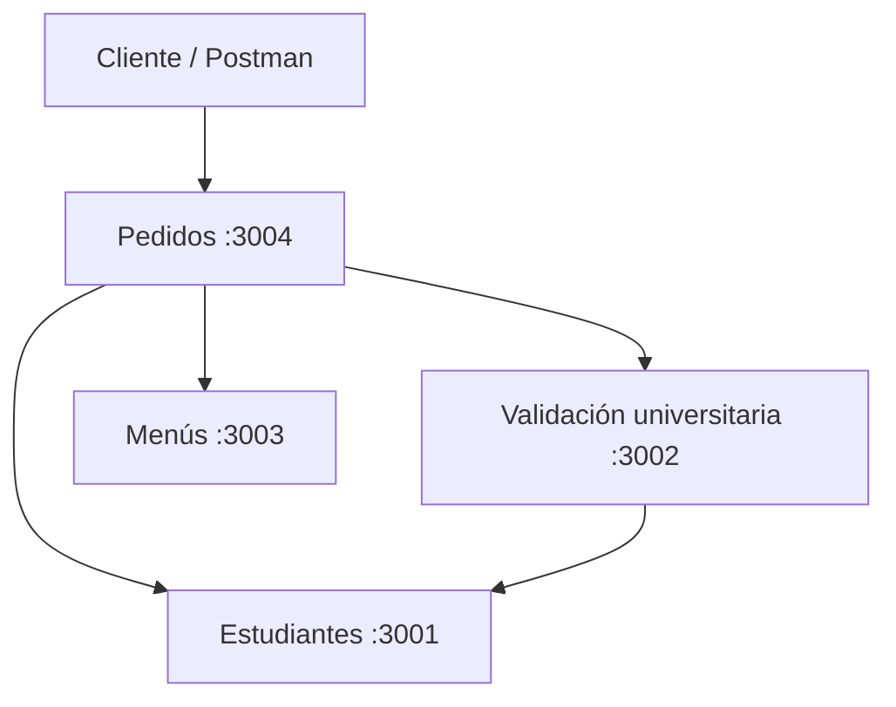

# Arquitectura implementada de UniFood

Cuatro API REST HTTP independientes en Node.js 24 y Express. Cada una administra su propia base SQLite. No hay acceso directo a bases de otros servicios, frontend, pagos, delivery ni integración SUNEDU.

| Servicio | Puerto |
| --- | --- |
| estudiantes | 3001 |
| validacion-universitaria | 3002 |
| menus | 3003 |
| pedidos | 3004 |

Las direcciones internas de Docker son `http://estudiantes:3001`, `http://validacion-universitaria:3002` y `http://menus:3003`.

Los endpoints de negocio están implementados y se describen en [contratos-api.md](contratos-api.md).

Pedidos consulta al estudiante y su validación más reciente; solo continúa si está `APROBADO`. Menús descuenta un cupo mediante `UPDATE ... WHERE cupos > 0`. Pedidos guarda la reserva en su SQLite y llama a `devolver-cupo` si falla el INSERT. El pedido sigue `PENDIENTE → LISTO → ENTREGADO`; el UPDATE compara también el estado anterior para impedir dos cambios concurrentes sobre la misma transición.

No existe una transacción distribuida entre SQLite y HTTP. La devolución se comprobó ante un error real de INSERT con Menús disponible. No hay reconciliación automática si falla también la devolución, ni garantía frente a una interrupción del proceso después del descuento.

## Persistencia y configuración

| Servicio | Archivo por defecto sin Docker | `DB_PATH` en Docker | Volumen |
|---|---|---|---|
| estudiantes | `services/estudiantes/data/estudiantes.sqlite` | `/app/data/estudiantes.sqlite` | `estudiantes_data` |
| validacion-universitaria | `./data/validaciones.sqlite`, relativo al directorio de trabajo del proceso | `/app/data/validaciones.sqlite` | `validaciones_data` |
| menus | `services/menus/data/menus.sqlite` | `/app/data/menus.sqlite` | `menus_data` |
| pedidos | `services/pedidos/pedidos.sqlite` | `/app/data/pedidos.sqlite` | `pedidos_data` |

Cada proceso acepta `PORT` y `DB_PATH`. Validación acepta `ESTUDIANTES_URL`; Pedidos acepta `ESTUDIANTES_URL`, `VALIDACIONES_URL` y `MENUS_URL`. Sin Docker las URLs por defecto usan `http://localhost:3001`, `:3002` y `:3003`. Compose configura las direcciones internas explícitamente; editar `.env.example` no las cambia. Aunque Pedidos declara `dotenv`, actualmente no lo invoca.

Los servicios crean directorios y tablas si no existen con `CREATE TABLE IF NOT EXISTS`. No hay migraciones ni datos semilla de negocio al arrancar. Las pruebas individuales usan memoria o directorios temporales; la integración crea cuatro bases aisladas y comprueba su persistencia tras reinicio.

## Arranque y salud

Todos escuchan en `0.0.0.0` y exponen `GET /health`. Los procesos de producción abren SQLite antes de escuchar. Compose espera `service_healthy` para las dependencias. Cada healthcheck consulta el puerto del propio contenedor cada cinco segundos.

`/health` confirma que la API responde; no realiza una consulta continua a SQLite ni verifica las dependencias. Si una dependencia está caída durante una reserva, Pedidos devuelve 503. Cada consulta HTTP interna tiene un timeout de tres segundos.

Los Dockerfiles usan `node:24-alpine` y `npm ci --omit=dev`. Menús y Pedidos incluyen herramientas para compilar módulos nativos. Pedidos inicia `index.js`; `src/app.js` delega en esa aplicación real y `src/index.js` se conserva como entrada compatible. `services/pedidos/Dockerfil` se conserva como archivo heredado; Compose usa `Dockerfile`.

Las versiones ejecutadas y el alcance de las comprobaciones están en [integracion-final.md](integracion-final.md).
